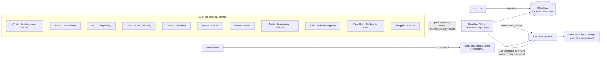

# Bot Office

Live **isometric ops floor** for a Grok Bot roster: every agent has a desk, walks there when it's working, and heads back to the lounge when it's idle. Vite + Three.js front end, Cloudflare Worker + SQLite Durable Object for real status and usage.

## Live demo

[bot-office.work-ahmedshakil.workers.dev](https://bot-office.work-ahmedshakil.workers.dev)

- **Simulation is public**: open [`?simulate=1`](https://bot-office.work-ahmedshakil.workers.dev/?simulate=1) (or just the root URL) and watch without a password.
- **Live floor is password-gated**: real roster status and the usage board need a sign-in (password not published).

## Preview


Video: [office-walkthrough.mp4](docs/demo/office-walkthrough.mp4) · [simulation-preview.mp4](docs/demo/simulation-preview.mp4)

## Screenshots

| Idle | Simulate Work | Live status |
|---|---|---|
|  |  |  |

## Orchestration



- **Live path** — bots push `idle | working | waiting | error | done` with a Bearer token; the Worker validates against its roster and stores it in the Durable Object; logged-in browsers poll it.
- **Guest path** — without a session the SPA gets 401 and auto-runs the simulation locally; nothing real is exposed. "Sign in for live status" opens the password gate.
- **Heartbeat** — cron keeps feed health fresh; the HUD warns when the feed is quiet 45+ min.

Roles and colors: [TEAM.md](TEAM.md).

## Features

- Eleven roster bots with department zones (Engineering shares two desks), lounge, glass lead office, usage wall board
- Public client-only **Simulate Work**; password + session cookie for the live feed
- Authenticated status push (`idle` / `working` / `waiting` / `error` / `done`)
- Real-time walk, sit and typing motion
- Feed-health warning when the cron heartbeat is quiet
- Weekday usage board (remaining + reset)

## Stack

- Vite + TypeScript + Three.js (orthographic isometric)
- Cloudflare Workers, static assets, SQLite Durable Objects
- Wrangler for deploy and secrets

## Local development

```bash
npm install
cp .dev.vars.example .dev.vars   # local-only secrets; never commit
npm run dev                      # http://localhost:5173
# optional: VITE_DEV_SKIP_AUTH=1 npm run dev
```

Worker locally:

```bash
npm run build && npx wrangler dev
```

## Deploy

```bash
npm run build
npx wrangler deploy
npx wrangler secret put OFFICE_SITE_PASSWORD
npx wrangler secret put STATUS_PUSH_TOKEN
```

Secret **names** only in docs — values stay in the Cloudflare dashboard / `wrangler secret`.

## Pushing bot status

```bash
export OFFICE_STATUS_URL=https://bot-office.<subdomain>.workers.dev
export OFFICE_STATUS_TOKEN=<STATUS_PUSH_TOKEN>
node scripts/push-status.mjs Alfred working "Reviewing deploy"
node scripts/push-status.mjs --usage 80 2026-11-01T12:47:00.000Z
```

## Docs

Architecture: [docs/ARCHITECTURE.md](docs/ARCHITECTURE.md). 
Design brief: [VISUAL.md](VISUAL.md). Recent polish notes: [VISUAL_CHANGELOG.md](VISUAL_CHANGELOG.md). Roster colors: [TEAM.md](TEAM.md).

## License

MIT — see [LICENSE](LICENSE).
