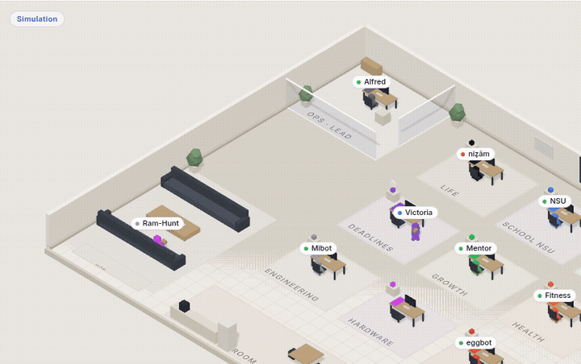
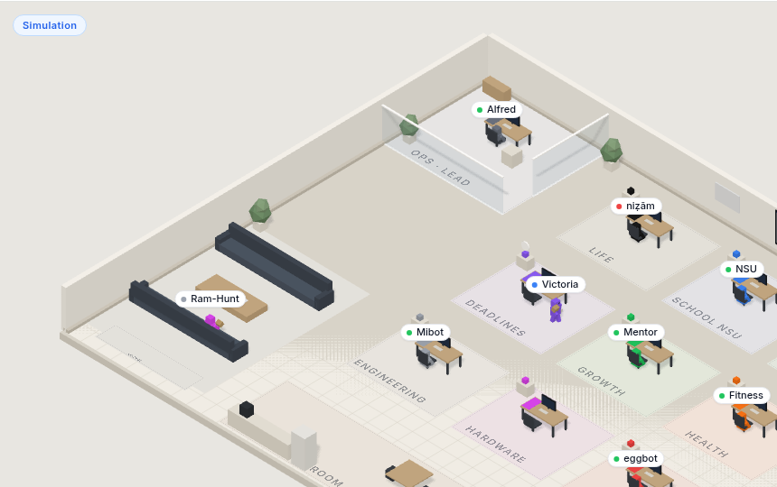
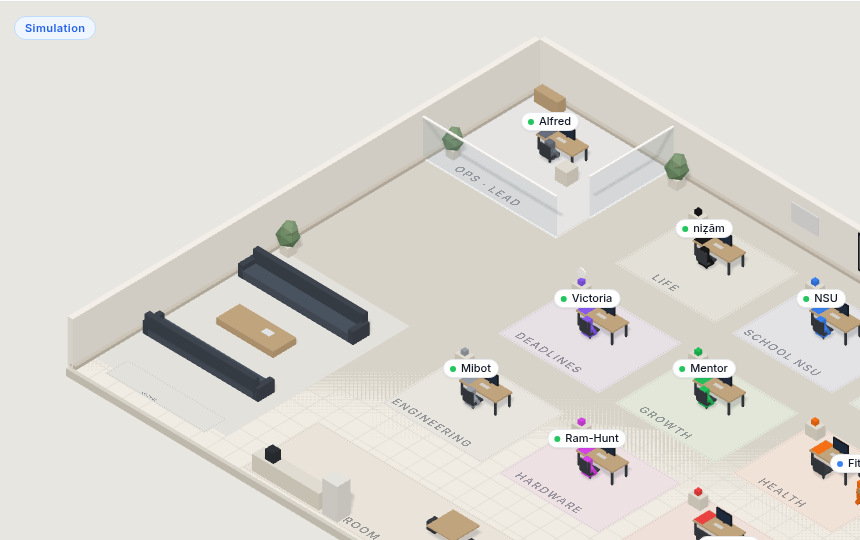
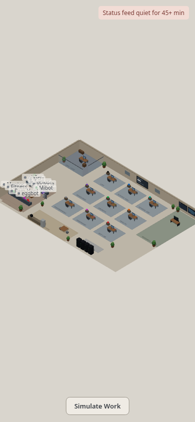

# Bot Office

Live **isometric ops floor** for a Grok Bot roster — Vite + Three.js front end, Cloudflare Worker + SQLite Durable Object for real status and usage.

**Live demo:** [bot-office.work-ahmedshakil.workers.dev](https://bot-office.work-ahmedshakil.workers.dev) (password-gated; password is not published here)

## Preview



Live capture of Simulate Work with bots at their desks. Clip: [docs/demo/office-walkthrough.mp4](docs/demo/office-walkthrough.mp4)

## Screenshots

| Desktop idle | Simulate Work |
|---|---|
|  |  |

| Live status feed | Phone |
|---|---|
|  |  |

## Features

- Ten roster bots with department zones, lounge, glass lead office, usage wall board
- Password gate + session cookie
- Authenticated status push (`idle` / `working` / `waiting` / `error` / `done`)
- Client-only **Simulate Work** / `?simulate=1`
- Feed-health warning when the Worker cron heartbeat is quiet
- Weekday usage board updates (remaining + reset)

## Architecture

See [docs/ARCHITECTURE.md](docs/ARCHITECTURE.md) for mermaid diagrams of the SPA, Worker, Durable Object, auth, and push path.

```text
Browser SPA  --cookie-->  Worker /api/*  -->  OfficeState DO
Grok Bots    --Bearer-->  Worker /api/status|/api/usage
Cron */5                 -->  heartbeat on DO
```

## Stack

- Vite + TypeScript + Three.js (orthographic isometric)
- Cloudflare Workers, static assets, SQLite Durable Objects
- Wrangler for deploy and secrets

## Local development

```bash
npm install
cp .dev.vars.example .dev.vars   # local-only secrets; never commit
npm run dev                      # http://localhost:5173
# optional: VITE_DEV_SKIP_AUTH=1 npm run dev
```

Worker locally:

```bash
npm run build && npx wrangler dev
```

## Deploy

```bash
npm run build
npx wrangler deploy
npx wrangler secret put OFFICE_SITE_PASSWORD
npx wrangler secret put STATUS_PUSH_TOKEN
```

Secret **names** only in docs — values stay in the Cloudflare dashboard / `wrangler secret`.

## Pushing bot status

```bash
export OFFICE_STATUS_URL=https://bot-office.<subdomain>.workers.dev
export OFFICE_STATUS_TOKEN=<STATUS_PUSH_TOKEN>
node scripts/push-status.mjs Alfred working "Reviewing deploy"
node scripts/push-status.mjs --usage 80 2026-11-01T12:47:00.000Z
```

## Visual system

Design brief: [VISUAL.md](VISUAL.md). Recent polish notes: [VISUAL_CHANGELOG.md](VISUAL_CHANGELOG.md). Roster colors: [TEAM.md](TEAM.md).

## License

MIT — see [LICENSE](LICENSE).
