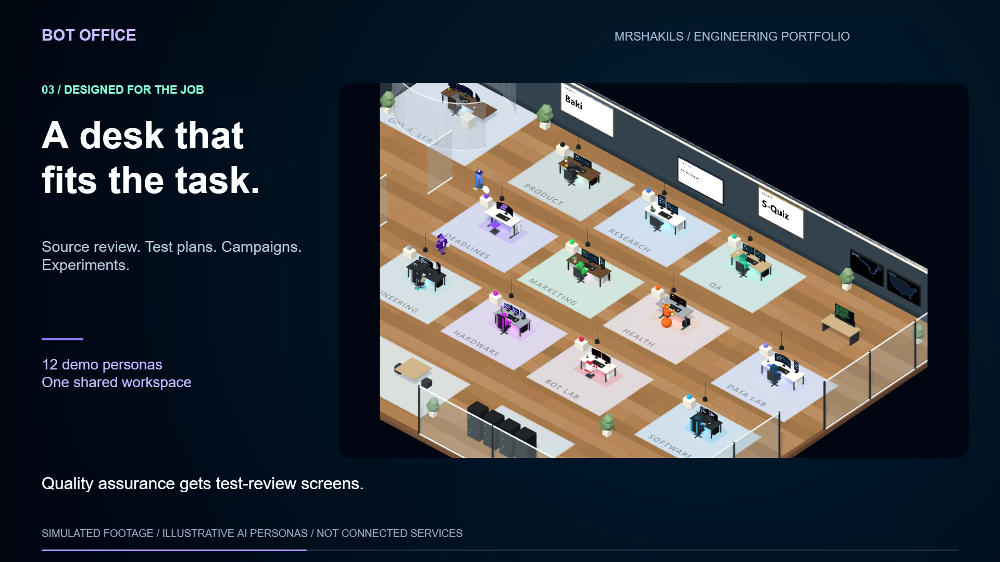
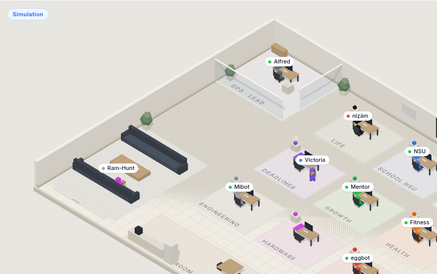
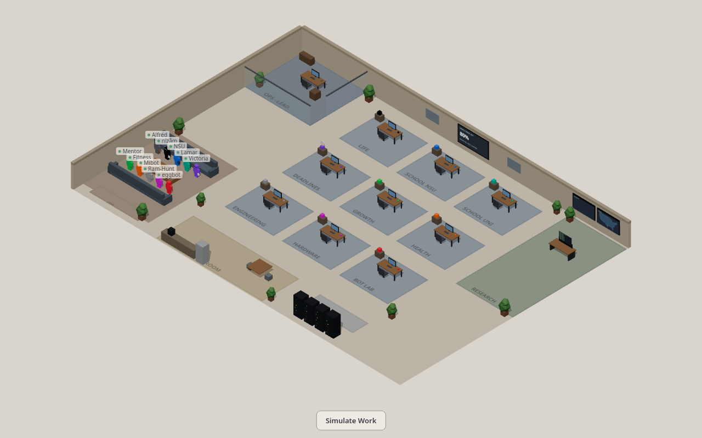
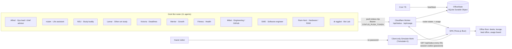

# Bot Office

Live **isometric ops floor** for a Grok Bot roster: every agent has a desk, walks there when it's working, and heads back to the lounge when it's idle. Vite + Three.js front end, Cloudflare Worker + SQLite Durable Object for real status and usage.

## Existing hosted deployment

[Cloudflare deployment](https://bot-office.work-ahmedshakil.workers.dev) — may lag this branch. Run locally or use the current Vercel branch preview to see the updated demo.

- **Simulation is public**: open [`?simulate=1`](https://bot-office.work-ahmedshakil.workers.dev/?simulate=1) (or just the root URL) and watch without a password.
- **Live floor is password-gated**: real roster status and the usage board need a sign-in (password not published).

## Public simulation team

The public demo shows a multidisciplinary team aligned with research, software development, quality assurance, and product communication. **Perplexity, Claude, Jasper, ChatGPT, and Gemini are illustrative personas, not connected services or endorsements.** All demo activity is generated locally in the browser.

| Demo bot | Department | Example simulated task |
|---|---|---|
| Alfred | Ops | Coordinates the demo team |
| ChatGPT | Product | Defines user needs and prioritizes features |
| Perplexity | Research | Compares sources and summarizes evidence |
| Claude | QA | Checks edge cases and reviews test plans |
| Victoria | Deadlines | Checks project milestones |
| Jasper | Marketing | Drafts launch stories and explains product value |
| Fitness | Health | Plans movement breaks |
| Mibot | Engineering | Reviews pull requests |
| Ram-Hunt | Hardware | Compares hardware options |
| eggbot | Bot Lab | Designs agent workflows |
| SWE | Software | Implements features |
| Gemini | Data Lab | Compares experiments and explores patterns |

The public demo replaces the two study personas, personal assistant, and growth mentor. The **live roster remains unchanged**: its real IDs, names, colors, and server-side status matching are preserved in `LIVE_TEAM` and [TEAM.md](TEAM.md). Demo IDs use a separate `demo-` namespace. Carpets, name tags, agent details, activity messages, and the directory all use the selected roster.

- Root URL and `?simulate=1`: public demo, no status polling.
- `?mode=live`: authenticated live feed; unauthorized visitors return to demo.
- **View live office** opens the password form. Cancel keeps the demo running.
- Switching modes loads a fresh scene so live identities cannot inherit demo labels.

## Preview



Earlier live-roster video: [office-walkthrough.mp4](docs/demo/office-walkthrough.mp4) · [simulation-preview.mp4](docs/demo/simulation-preview.mp4)

## Earlier live-roster screenshots

| Idle | Simulate Work | Live status |
|---|---|---|
|  |  |  |

## Orchestration



- **Live path** — bots push `idle | working | waiting | error | done` with a Bearer token; the Worker validates against its roster and stores it in the Durable Object; logged-in browsers poll it.
- **Guest path** — the default page runs a separate simulation roster locally without polling the live API. Unauthorized live requests return to the demo. "Sign in for live status" opens the password gate.
- **Heartbeat** — cron keeps feed health fresh; the HUD warns when the feed is quiet 45+ min.

Live roles and colors: [TEAM.md](TEAM.md). Demo roles are listed above.

## Features

- Twelve demo personas / eleven live bots with separate department workstations, lounge, glass lead office, usage wall board
- Public client-only **Simulate Work**; password + session cookie for the live feed
- Authenticated status push (`idle` / `working` / `waiting` / `error` / `done`)
- Real-time walk, sit and typing motion
- Feed-health warning when the cron heartbeat is quiet
- Weekday usage board (remaining + reset)

## Stack

- Vite + TypeScript + Three.js (orthographic isometric)
- Cloudflare Workers, static assets, SQLite Durable Objects
- Wrangler for deploy and secrets

## Local development

```bash
npm install
cp .dev.vars.example .dev.vars   # local-only secrets; never commit
npm run dev                      # http://localhost:5173
# optional: VITE_DEV_SKIP_AUTH=1 npm run dev
```

Worker locally:

```bash
npm run build && npx wrangler dev
```

## Deploy

```bash
npm run build
npx wrangler deploy
npx wrangler secret put OFFICE_SITE_PASSWORD
npx wrangler secret put STATUS_PUSH_TOKEN
```

Secret **names** only in docs — values stay in the Cloudflare dashboard / `wrangler secret`.

## Pushing bot status

```bash
export OFFICE_STATUS_URL=https://bot-office.<subdomain>.workers.dev
export OFFICE_STATUS_TOKEN=<STATUS_PUSH_TOKEN>
node scripts/push-status.mjs Alfred working "Reviewing deploy"
node scripts/push-status.mjs --usage 80 2026-11-01T12:47:00.000Z
```

## Docs

Architecture: [docs/ARCHITECTURE.md](docs/ARCHITECTURE.md). 
Design brief: [VISUAL.md](VISUAL.md). Recent polish notes: [VISUAL_CHANGELOG.md](VISUAL_CHANGELOG.md). Roster colors: [TEAM.md](TEAM.md).

## License

MIT — see [LICENSE](LICENSE).

## Control-room redesign

The redesign branch adds a dark team directory, selected-agent details, observed activity, camera controls and a responsive Team panel. Old reports retain their reported state with a stale indicator. Demo usage is unavailable rather than invented. Normal trips no longer use distance-based teleportation; live completion does not fabricate a handoff.

Vercel hosting uses vercel.json to proxy API requests to the existing Cloudflare Worker. The Durable Object remains on Cloudflare. See docs/REDESIGN-VERIFICATION.md for verification limits.

## Role-specific workstations

Research has portrait source-review and landscape evidence screens; QA has two test-review screens; Marketing has campaign and vertical content screens; Product has an ultrawide roadmap; Gemini has a dedicated Data Lab desk with experiment screens. All new screen content is marked DEMO. The live workstation configurations are preserved. Twelve lounge seats support the demo roster, with low perimeter planting and a warmer lounge palette.

## Portfolio demo video

The marketing package presents this as a **3D interface for understanding agent status**, not proof of autonomous execution or third-party integrations. It uses footage rendered by this app, clearly marked simulated, with plain-language narration and captions. It makes no productivity, hiring, customer, or performance claims.

See [the production notes and upload copy](docs/marketing/README.md). Videos are generated locally rather than adding large media files to Git.
