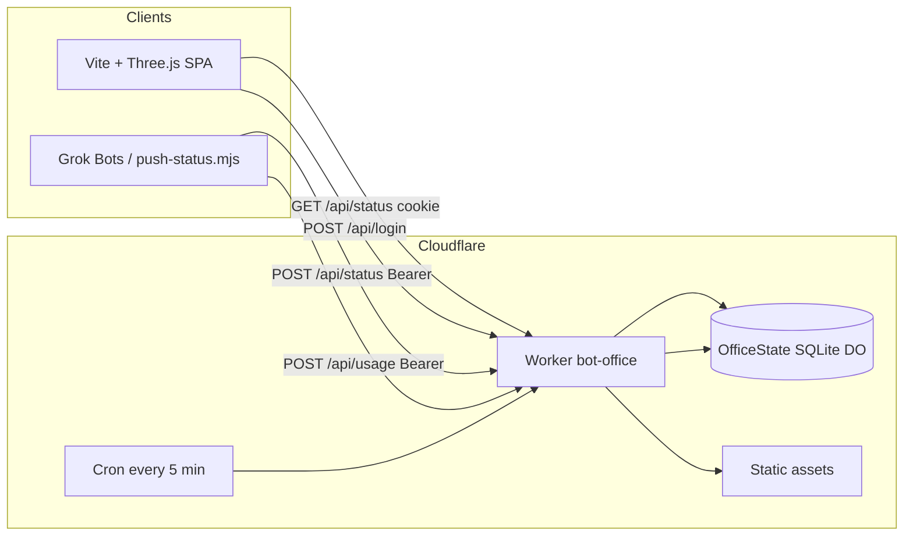

# Architecture

Bot Office is a password-gated **isometric ops floor** that mirrors live Grok Bot roster state. The browser never holds push credentials; bots publish status to a Worker that stores state in a Durable Object.

## System context



## Request paths

| Path | Auth | Role |
|------|------|------|
| `POST /api/login` | Shared site password | Sets `office_session` HttpOnly cookie (7d, HMAC) |
| `GET /api/status` | Session cookie | Returns bots, usage, `feedHealthy` |
| `POST /api/status` | `Authorization: Bearer STATUS_PUSH_TOKEN` | Upsert one roster bot |
| `POST /api/usage` | Bearer token | Weekly remaining + reset |
| `/*` | — | SPA from `ASSETS` (`run_worker_first` for `/api/*`) |

## Durable Object `OfficeState`

Single DO id `office` holds:

- `bots`: map of roster UUID → `{ id, name, state, statusLine, updatedAt }`
- `usage`: `{ remaining, resetAt, updatedAt }`
- `lastHeartbeat`: ISO time from cron (feed healthy if &lt; 45 minutes old)

Unknown bots are rejected. Status lines are sanitized (URLs/emails/long digit runs masked, max 120 chars).

## Frontend effective state

- Poll `/api/status` every 20s.
- `working` / `waiting` older than **10 minutes** render as idle.
- Long lounge→desk trips **snap**; short hops walk.
- `?simulate=1` or **Simulate Work** runs a client-only day (no API writes).

## Status publishers

Bots source `/home/box/agent-data/bot-office-status.env` (never committed) and run:

```bash
node scripts/push-status.mjs <name-or-uuid> <idle|working|waiting|error|done> "short line"
node scripts/push-status.mjs --usage <remaining> <resetAt-ISO>
```

## Security notes

- Site password and push token are **Worker secrets only**.
- Cookie: `Secure; HttpOnly; SameSite=Strict`.
- Push token compared via HMAC digest equality helper.
- Do not put secrets in git, chat, or screenshots.
